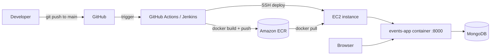

# Events App

A full-stack platform to discover and publish local events. Visitors can browse and search events by category, registered users can submit their own events and bookmark the ones they like, and an admin reviews every submission before it goes live.

The whole app ships as a **single Docker image** and is deployed to **AWS** (Amazon ECR + EC2) through a **CI/CD pipeline** available both in **GitHub Actions** and **Jenkins**.

## Features

- **Browse and search** published events, filtered by category (Music, Sports, Cultural, Food, Art, Tech, Community, Other) or by text in title, description or location
- **Event details**: date, time, venue and address, ticket price (or free), organizer contact info and image
- **User accounts** with registration, login and logout (JWT in HTTP-only cookies, passwords hashed with bcrypt)
- **Submit events**, including image upload (images only, max 5 MB)
- **Moderation workflow**: events from regular users start as `pending`; an admin can approve (`published`) or reject them. Events created by the admin are published directly
- **Admin dashboard** with platform statistics (total, pending, published and rejected events, total users)
- **Bookmarks**: save events and check whether an event is already saved

## Architecture



The Dockerfile uses a **multi-stage build**:

1. **Stage 1** (`node:20-alpine`): installs the frontend dependencies and builds the React app
2. **Stage 2** (`python:3.11-slim`): installs the backend dependencies, copies the API and the compiled frontend into `./static`

At runtime, FastAPI serves both the REST API (under `/api`) and the compiled React app from the same container on port `8000`.

## Tech stack

| Layer | Technologies |
|---|---|
| Frontend | React 19, React Router 7, Tailwind CSS, Radix UI components, Axios (built with CRACO) |
| Backend | Python 3.11, FastAPI, Uvicorn, Motor (async MongoDB driver), PyJWT, bcrypt |
| Database | MongoDB |
| Containers | Docker (multi-stage build) |
| CI/CD | GitHub Actions, Jenkins |
| Cloud | AWS: ECR (image registry) and EC2 (hosting) |

## Project structure

```
.
├── backend/
│   ├── server.py            # FastAPI app: auth, events, admin, bookmarks, uploads
│   └── requirements.txt
├── frontend/                # React app (pages: home, event detail, submit, bookmarks, admin)
├── .github/workflows/
│   └── deploy.yml           # GitHub Actions pipeline
├── Jenkinsfile              # Jenkins pipeline
├── Dockerfile               # Multi-stage build (frontend + backend)
└── backend_test.py          # API tests
```

## Configuration

The backend reads these environment variables:

| Variable | Required | Description |
|---|---|---|
| `MONGO_URL` | Yes | MongoDB connection string |
| `DB_NAME` | Yes | Database name (the deployment uses `events_db`) |
| `JWT_SECRET` | Recommended | Secret used to sign tokens. If missing, a random one is generated at startup, so sessions are lost on every restart |
| `ADMIN_EMAIL` | Recommended | Email of the admin user created on first startup |
| `ADMIN_PASSWORD` | Recommended | Password of the admin user. **Always set your own value**; the code ships with a development default |

On startup the API creates the required indexes (unique user email, unique bookmark per user and event) and seeds the admin user.

## Run it locally

**With Docker**

```bash
docker build -t events-app .

docker run -d --name events-app -p 8000:8000 \
  -e MONGO_URL="mongodb://<host>:27017" \
  -e DB_NAME="events_db" \
  -e JWT_SECRET="change-me" \
  -e ADMIN_EMAIL="admin@example.com" \
  -e ADMIN_PASSWORD="change-me-too" \
  events-app
```

The app is then available at `http://localhost:8000`.

**Without Docker (development)**

```bash
# Backend
cd backend
python -m venv .venv && source .venv/bin/activate
pip install -r requirements.txt
export MONGO_URL="mongodb://localhost:27017" DB_NAME="events_db"
uvicorn server:app --reload --port 8000

# Frontend (in another terminal)
cd frontend
npm install --legacy-peer-deps
REACT_APP_BACKEND_URL="http://localhost:8000" npm start
```

## API overview

All endpoints are under `/api`.

| Method | Endpoint | Access | Description |
|---|---|---|---|
| POST | `/auth/register` | Public | Create an account |
| POST | `/auth/login` | Public | Log in |
| POST | `/auth/logout` | Public | Log out (clears the session cookies) |
| GET | `/auth/me` | Authenticated | Current user |
| GET | `/categories` | Public | List of categories |
| GET | `/events` | Public | Published events (`category`, `search`, `limit`, `skip`) |
| GET | `/events/{id}` | Public | Event details |
| POST | `/events` | Authenticated | Submit an event (pending unless the user is admin) |
| POST | `/upload/image` | Public | Upload an image (max 5 MB), returns a data URL |
| GET | `/bookmarks` | Authenticated | User's bookmarked events |
| POST | `/bookmarks/{event_id}` | Authenticated | Bookmark an event |
| DELETE | `/bookmarks/{event_id}` | Authenticated | Remove a bookmark |
| GET | `/bookmarks/check/{event_id}` | Authenticated | Is the event bookmarked? |
| GET | `/admin/events` | Admin | List events for moderation |
| GET | `/admin/stats` | Admin | Platform statistics |
| POST | `/admin/events/{id}/approve` | Admin | Publish a pending event |
| POST | `/admin/events/{id}/reject` | Admin | Reject an event |
| DELETE | `/admin/events/{id}` | Admin | Delete an event |

## CI/CD

### GitHub Actions (`.github/workflows/deploy.yml`)

Triggered on every push to `main`:

1. **Build and push**: checks out the code, runs `pytest` on the backend, authenticates to AWS, builds the Docker image and pushes it to **Amazon ECR** tagged with the commit SHA and `latest`
2. **Deploy** (only if the previous job succeeds): connects to the EC2 instance over SSH, logs in to ECR, pulls the new image, replaces the running container and starts it with `--restart always`

Required repository secrets: `AWS_ACCESS_KEY_ID`, `AWS_SECRET_ACCESS_KEY`, `AWS_ACCOUNT_ID`, `EC2_SSH_KEY`, `MONGO_URL`.

### Jenkins (`Jenkinsfile`)

The same flow as a declarative pipeline with the stages **Checkout → Run tests → Docker build → Push to ECR → Deploy to EC2**. It uses a Jenkins AWS credentials binding for ECR and the SSH Agent plugin for the deployment.

## Infrastructure

- **Registry**: Amazon ECR repository `events-app` (region `us-east-1`)
- **Hosting**: EC2 instance running the container on port `8000`, reachable through a DuckDNS domain
- **Database**: MongoDB, configured through `MONGO_URL`
